# FinTrack — Personal Finance Tracker

FinTrack adalah aplikasi web sederhana untuk mencatat dan mengelola transaksi keuangan pribadi. Aplikasi ini dikembangkan sebagai implementasi tugas **Bab 9 – NestJS Dasar dan Struktur MVC**, dengan integrasi frontend React dan backend NestJS.

Pengguna dapat melihat ringkasan keuangan, menambahkan transaksi, mengubah data transaksi, dan menghapus transaksi.

## 1. Teknologi yang Digunakan

### Frontend
- React
- Vite
- JavaScript
- CSS
- Fetch API

### Backend
- NestJS
- Node.js
- TypeScript
- class-validator
- class-transformer
- REST API
- In-memory array sebagai penyimpanan data sementara

## 2. Fitur Aplikasi

- Menampilkan daftar transaksi keuangan.
- Menampilkan ringkasan total pemasukan, pengeluaran, dan saldo.
- Menambahkan transaksi baru.
- Mengubah transaksi yang sudah tersimpan.
- Menghapus transaksi.
- Memvalidasi data transaksi sebelum diproses backend.
- Menangani kondisi data tidak ditemukan.

## 3. Struktur Folder

```text
FinTrack/
├── backend/
│   ├── src/
│   │   ├── transactions/
│   │   │   ├── dto/
│   │   │   │   ├── create-transaction.dto.ts
│   │   │   │   └── update-transaction.dto.ts
│   │   │   ├── entities/
│   │   │   │   └── transaction.entity.ts
│   │   │   ├── transactions.controller.ts
│   │   │   ├── transactions.module.ts
│   │   │   └── transactions.service.ts
│   │   ├── app.module.ts
│   │   └── main.ts
│   ├── transactions.http
│   └── package.json
│
├── frontend/
│   ├── src/
│   │   ├── assets/
│   │   ├── components/
│   │   │   ├── Navbar.jsx
│   │   │   ├── SummaryCards.jsx
│   │   │   ├── TransactionForm.jsx
│   │   │   ├── TransactionItem.jsx
│   │   │   └── TransactionList.jsx
│   │   ├── App.jsx
│   │   ├── App.css
│   │   ├── index.css
│   │   └── main.jsx
│   └── package.json
│
├── docs/
│   └── screenshots/
│       ├── get-all-transactions.jpeg
│       ├── get-transaction-by-id.jpeg
│       ├── post-create-transaction.jpeg
│       ├── patch-update-transaction.jpeg
│       ├── delete-transaction.jpeg
│       ├── validation-error-400.jpeg
│       ├── not-found-exception-404.jpeg
│       ├── frontend-dashboard.jpeg
│       ├── frontend-create-transaction.jpeg
│       ├── frontend-update-transaction.jpeg
│       └── frontend-delete-transaction.jpeg
│
└── README.md
```

## 4. Implementasi Backend NestJS

Backend menggunakan pendekatan pemisahan tanggung jawab antara Entity, DTO, Module, Controller, dan Service.

### 4.1 Entity Transaction

Entity `Transaction` memiliki enam atribut utama:

| Atribut | Tipe Data | Keterangan |
|---|---|---|
| id | number | Identitas transaksi |
| title | string | Nama transaksi |
| amount | number | Nominal transaksi |
| type | 'income' / 'expense' | Jenis transaksi |
| category | string | Kategori transaksi |
| date | string | Tanggal transaksi |

### 4.2 Service

`transactions.service.ts` bertanggung jawab atas pengelolaan data transaksi menggunakan array sementara (*in-memory array*).

Operasi yang tersedia:
- `findAll()` — mengambil seluruh transaksi.
- `findOne()` — mengambil transaksi berdasarkan ID.
- `create()` — menambahkan transaksi.
- `update()` — memperbarui transaksi.
- `remove()` — menghapus transaksi.

Data awal disediakan sebagai data contoh. Karena penyimpanan menggunakan in-memory array, perubahan data akan kembali ke data awal ketika backend dijalankan ulang.

### 4.3 Controller

`transactions.controller.ts` menangani HTTP request dan menghubungkannya dengan Service melalui Dependency Injection.

Controller menyediakan endpoint untuk operasi CRUD, termasuk pengambilan transaksi berdasarkan ID.

### 4.4 DTO dan Validasi

Validasi data dilakukan menggunakan `class-validator` dan `class-transformer`.

Pada `CreateTransactionDto`, aturan validasi meliputi:

| Field | Aturan Validasi |
|---|---|
| title | Harus berupa string, tidak boleh kosong, minimal 3 karakter |
| amount | Harus berupa angka dan minimal 1 |
| type | Hanya menerima `income` atau `expense` |
| category | Harus berupa string dan tidak boleh kosong |
| date | Harus menggunakan format tanggal yang valid |

`UpdateTransactionDto` menggunakan `PartialType` sehingga seluruh field pada DTO Create dapat dikirim secara opsional ketika melakukan pembaruan.

Validasi diterapkan secara global melalui `ValidationPipe` di `main.ts`, dengan konfigurasi `whitelist`, `forbidNonWhitelisted`, dan `transform`.

### 4.5 Exception Handling

Backend menangani beberapa kondisi kesalahan, di antaranya:

- **400 Bad Request:** terjadi ketika data yang dikirim tidak memenuhi aturan validasi.
- **404 Not Found:** terjadi ketika transaksi dengan ID yang diminta tidak ditemukan.

## 5. REST API Endpoint

Base URL:

```text
http://localhost:3000
```

| Method | Endpoint | Fungsi |
|---|---|---|
| GET | `/transactions` | Mengambil seluruh transaksi |
| GET | `/transactions/:id` | Mengambil transaksi berdasarkan ID |
| POST | `/transactions` | Menambahkan transaksi |
| PATCH | `/transactions/:id` | Memperbarui transaksi |
| DELETE | `/transactions/:id` | Menghapus transaksi |

Contoh request untuk menambahkan transaksi:

```json
{
  "title": "Uang Saku",
  "amount": 1000000,
  "type": "income",
  "category": "Allowance",
  "date": "2026-11-23"
}
```

Pengujian endpoint dilakukan menggunakan file `backend/transactions.http` melalui REST Client pada Visual Studio Code.

## 6. Integrasi Frontend dan Backend

Frontend React terhubung dengan backend NestJS menggunakan Fetch API.

Integrasi dilakukan melalui beberapa operasi:

1. **Read:** mengambil data transaksi dari endpoint GET.
2. **Create:** mengirim data transaksi baru menggunakan POST.
3. **Update:** memperbarui transaksi menggunakan PATCH.
4. **Delete:** menghapus transaksi menggunakan DELETE.

Frontend juga memperbarui ringkasan pemasukan, pengeluaran, dan saldo berdasarkan data transaksi yang diterima dari backend.

Backend mengaktifkan CORS untuk mengizinkan frontend yang berjalan pada `http://localhost:5173` mengakses API.

## 7. Cara Menjalankan Aplikasi

Pastikan Node.js dan npm sudah terpasang.

### 7.1 Menjalankan Backend

Buka terminal pertama:

```powershell
cd backend
npm install
npm run start:dev
```

Backend berjalan pada:

```text
http://localhost:3000
```

### 7.2 Menjalankan Frontend

Buka terminal kedua:

```powershell
cd frontend
npm install
npm run dev
```

Frontend berjalan pada:

```text
http://localhost:5173
```

Buka alamat frontend tersebut melalui browser.

## 8. Hasil Pengujian Backend

Pengujian API dilakukan untuk memastikan seluruh endpoint CRUD dan penanganan kesalahan berjalan sesuai harapan.

### 8.1 GET All Transactions

Memastikan backend dapat mengembalikan seluruh data transaksi.

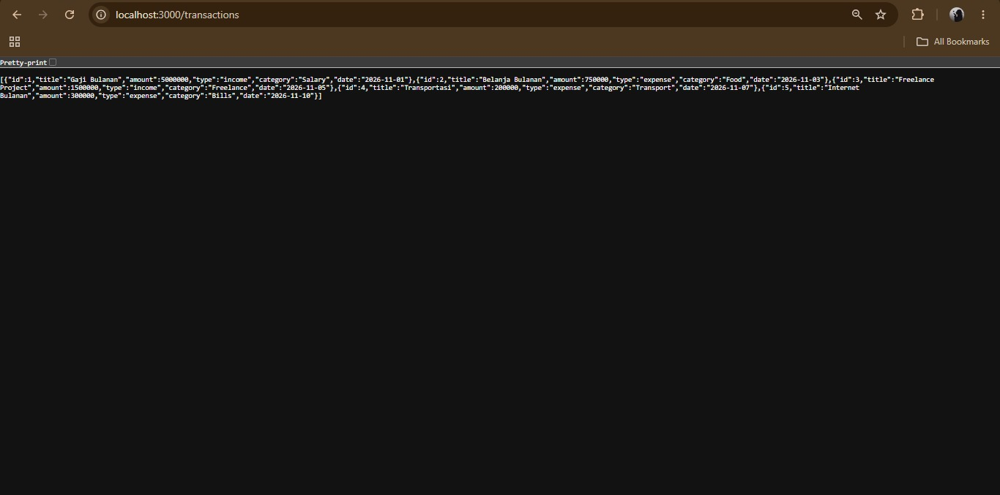

### 8.2 GET Transaction by ID

Memastikan backend dapat mengambil satu transaksi berdasarkan ID.

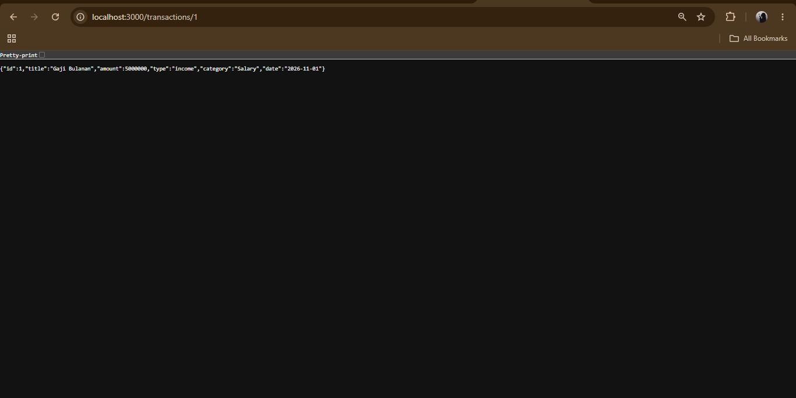

### 8.3 POST Create Transaction

Memastikan backend dapat menerima dan menyimpan transaksi baru.

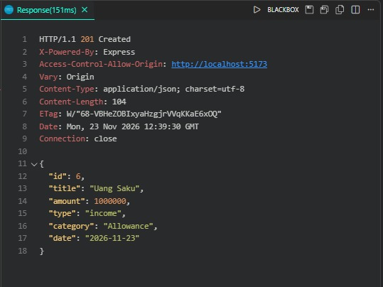

### 8.4 PATCH Update Transaction

Memastikan backend dapat memperbarui data transaksi berdasarkan ID.

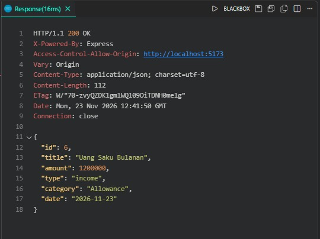

### 8.5 DELETE Transaction

Memastikan backend dapat menghapus transaksi berdasarkan ID.

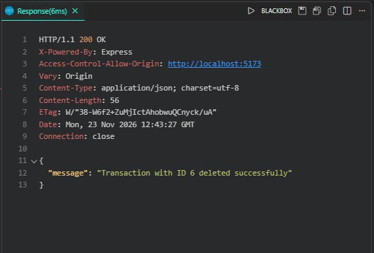

### 8.6 Validation Error — 400 Bad Request

Pengujian dilakukan dengan mengirim data yang tidak sesuai aturan validasi.

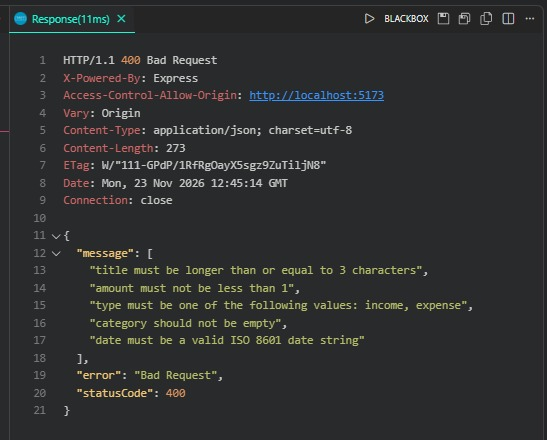

### 8.7 Not Found Exception — 404 Not Found

Pengujian dilakukan dengan meminta transaksi menggunakan ID yang tidak tersedia.

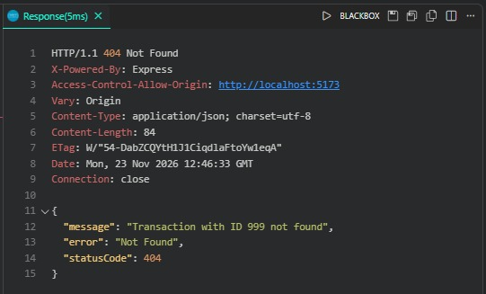

## 9. Hasil Pengujian Frontend

Pengujian integrasi dilakukan melalui antarmuka aplikasi untuk memastikan pengguna dapat melakukan seluruh operasi CRUD.

### 9.1 Dashboard

Menampilkan ringkasan keuangan dan daftar transaksi.

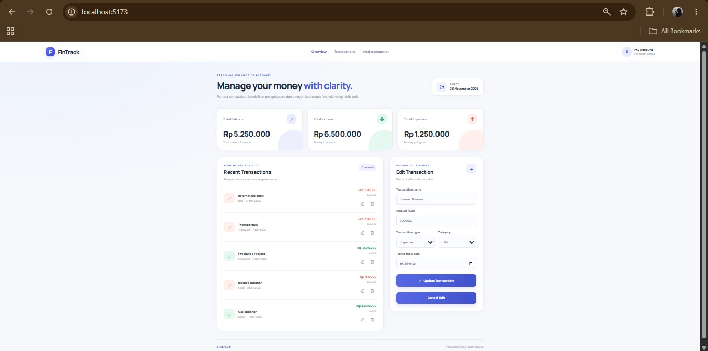

### 9.2 Create Transaction

Memastikan pengguna dapat menambahkan transaksi melalui formulir.

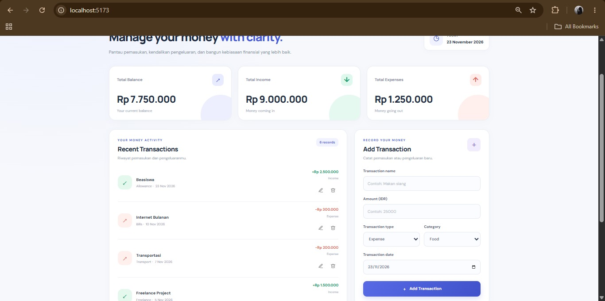

### 9.3 Update Transaction

Memastikan pengguna dapat mengubah informasi transaksi yang sudah tersedia.

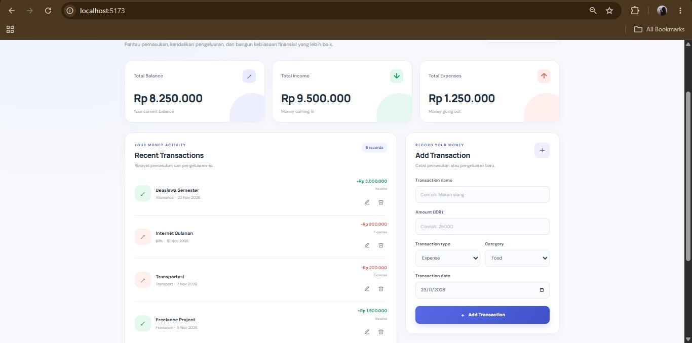

### 9.4 Delete Transaction

Memastikan pengguna dapat menghapus transaksi melalui antarmuka aplikasi.

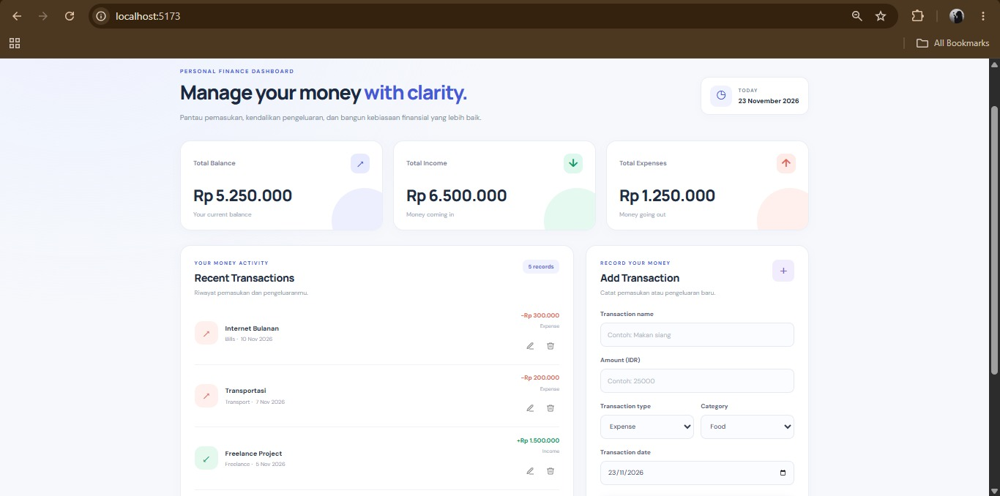

## 10. Build Verification

Build frontend dan backend telah dijalankan untuk memeriksa kesiapan aplikasi.

Frontend:

```powershell
cd frontend
npm run build
```

Backend:

```powershell
cd backend
npm run build
```

Kedua proses build telah berhasil dijalankan tanpa error.

## 11. Catatan

- Aplikasi menggunakan penyimpanan sementara berupa in-memory array, bukan database permanen.
- Data transaksi akan kembali ke data awal setelah backend dijalankan ulang.
- Frontend dan backend harus berjalan bersamaan agar seluruh fitur aplikasi dapat digunakan.
- Pengujian API dilakukan menggunakan REST Client dan pengujian CRUD dilakukan melalui antarmuka frontend.

---

**FinTrack — Personal Finance Tracker**
Developed as part of the Web Programming coursework.